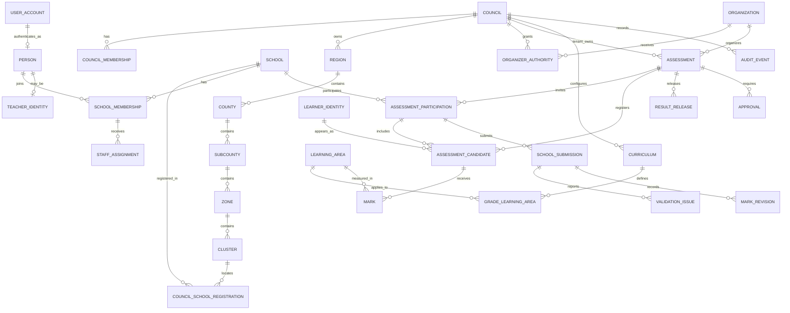

# CBE Platform — Conceptual Domain Model & Logical ERD

**Status:** Proposed — for domain review, not approved for physical migration  
**Baseline date:** 2026-11-23  
**Implementation:** Next.js App Router + PostgreSQL + Prisma

## 1. Modelling decisions and boundaries

This model separates four concepts that the current implementation tends to combine:

1. **Tenant ownership:** a Council is the tenant boundary for council-owned data.
2. **Canonical identity:** a School, TeacherIdentity and LearnerIdentity represent real-world identities and should not be duplicated to represent membership or participation.
3. **Scoped relationships:** SchoolCouncilRegistration, SchoolMembership, StaffAssignment and AssessmentParticipation express where and how an identity is associated.
4. **Assessment workflow:** candidates, marks, submissions, validation, approval and release belong to a particular assessment and its participating schools.

An independent examination organiser is represented as an Organization. An OrganizerAuthority relationship records which council permits that organization to organize an assessment within the council's tenant boundary. Whether organisers may operate independently across multiple councils without a sponsoring council remains an open business decision.

## 2. Conceptual ERD

**Interpretation:** this is a conceptual relationship map. It intentionally omits some join entities and fields for readability. The logical model below defines the important associations and proposed constraints.

## 3. Logical entity catalogue

### 3.1 Platform, tenant and organizer

| Entity | Key relationships | Ownership / purpose |
|---|---|---|
| PlatformOperator | linked to UserAccount | Platform-controlled operator identity; provisioned by the platform owner, not self-registered as a school user |
| Council | owns geography, council configuration, school registrations and assessment tenant data | Tenant root; independent council data boundary |
| CouncilMembership | Council + Person/UserAccount | Council-scoped administration and permissions; exact council roles need validation |
| Organization | may receive OrganizerAuthority and organize Assessments | Canonical independent body, which may be a council or external organizer |
| OrganizerAuthority | Council + Organization | Explicit grant of authority, scope, validity dates and status; prevents an organizer from gaining access merely by knowing an assessment ID |

**Important:** do not treat `Organization` and `Council` as synonyms. A council is a tenant. An organizer is an organization authorized to run an assessment. An organization may be linked to more than one council only through explicit authority records.

### 3.2 Geography and schools

| Entity | Key relationships | Ownership / purpose |
|---|---|---|
| Region → County → Subcounty → Zone → Cluster | Parent-child hierarchy | Geography is owned by a Council; names and uniqueness are scoped to the parent and council |
| School | canonical identity | Represents the institution independently of any one council or assessment |
| CouncilSchoolRegistration | Council + School + Cluster | Registers a canonical school in a council's registry and places it in that council's geography; carries council-specific school code/status and effective dates |

**Accepted domain rule (2026-11-23):** one canonical School may hold active or historical registrations with multiple independent Councils. Do not store a single `councilId` or `clusterId` directly on canonical School. The council-specific geography, code, registration number, status and effective dates belong on each CouncilSchoolRegistration. A registration with Council X grants no access to Council Y's tenant data.

**Accepted domain rule (2026-11-23):** every Assessment belongs to exactly one Council. `Assessment.councilId` is mandatory; assessment ownership is not shared or inferred from participating schools. A school participates only through its CouncilSchoolRegistration for that same Council. The logical design uses composite foreign keys to prevent a participation from pairing an assessment owned by one council with a registration owned by another council.

### 3.3 People, accounts and school staffing

| Entity | Key relationships | Ownership / purpose |
|---|---|---|
| Person | may have UserAccount, TeacherIdentity and SchoolMembership records | Global human identity record, with minimal identifying data |
| UserAccount | optionally linked to Person; has credentials and account status | Authentication principal. A login account is not the same thing as a school membership |
| TeacherIdentity | one-to-one with Person | Global teacher identity and verified professional identifiers; uniqueness must be based on verified issuer/identifier, not name |
| SchoolMembership | Person + School (and normally CouncilSchoolRegistration) | School-specific association, status, dates and school-scoped role |
| StaffAssignment | SchoolMembership + optional grade/class/learning-area scope | Operational duties such as subject teacher or class teacher; assignment is not a new person identity |

The initial school registrant becomes the initial School Administrator, but the membership and school remain pending until platform approval. A pending membership must not grant school-management capabilities. A School Administrator may create a teacher identity or attach an existing global teacher identity to the school; this must not create a duplicate teacher.

Platform Administrators remain platform-scoped identities and must not be represented as ordinary school memberships.

### 3.4 Curriculum and grading

| Entity | Key relationships | Purpose |
|---|---|---|
| Curriculum | Council-owned or explicitly shared/versioned configuration | Defines curriculum version and applicability |
| Grade | canonical grade level, currently Grades 1–9 | Avoid free-text grade values |
| LearningArea | canonical or council-configured learning area | Reusable learning area identity |
| GradeLearningArea | Curriculum + Grade + LearningArea | Defines which learning areas apply to each grade and in which order |
| GradingRubric | Council + curriculum/grade + version | Versioned grading policy |
| RubricLevel | GradingRubric + level | Stores configurable labels and boundaries; do not hard-code unconfirmed thresholds |

An assessment must snapshot or reference immutable curriculum and rubric versions so a later configuration change cannot silently rewrite historical results.

### 3.5 Assessment and participation

| Entity | Key relationships | Purpose |
|---|---|---|
| Assessment | Council tenant + Organizer + assessment period/type | The assessment aggregate; records who owns the tenant data and who is authorized to organize it |
| AssessmentGrade | Assessment + Grade | Grades covered by the assessment |
| AssessmentLearningArea | Assessment + GradeLearningArea | Learning areas actually assessed for each grade |
| AssessmentWindow | Assessment + window type | Candidate registration, mark entry, correction and submission deadlines |
| AssessmentParticipation | Assessment + CouncilSchoolRegistration | A school's participation in a particular assessment, with invitation/acceptance/status |

School identity is not copied for every assessment. The assessment joins to a council-specific school registration through AssessmentParticipation. This also ensures an assessment only includes schools registered in the relevant council unless a separately approved cross-council participation rule exists.

### 3.6 Learners, candidates and marks

| Entity | Key relationships | Purpose |
|---|---|---|
| LearnerIdentity | global unique learner identifier | Learner has no login account; the identifier is not a password or authentication secret |
| AssessmentCandidate | Assessment + AssessmentParticipation + LearnerIdentity + Grade | Assessment-specific candidate registration, including required name/gender snapshots and registration status |
| Mark | AssessmentCandidate + AssessmentLearningArea | Final numerical mark for one candidate in one configured learning area |
| MarkRevision | Mark + actor + reason | Append-only record of corrections, previous/new values, timestamp and approval context |
| MarkEntryBatch | AssessmentParticipation + actor | Optional grouping for import/manual entry, idempotency and validation tracking |

Proposed integrity rules:
- A learner may appear at most once in an assessment, unless the business rules explicitly permit separate candidate entries by paper/session.
- A candidate must belong to the same assessment as the participation record.
- A candidate's grade must be included in the assessment and the learning area must apply to that grade.
- A mark must reference a learning area configured for that assessment and candidate grade.
- Marks must be within the assessment's configured range and precision.
- Mark correction must retain prior values and the actor/reason; do not overwrite without history.

### 3.7 Submission, validation, approval and release

| Entity | Key relationships | Purpose |
|---|---|---|
| SchoolSubmission | AssessmentParticipation + submission version + actor | Formal school submission; marks entered are not automatically submitted |
| ValidationIssue | SchoolSubmission + field/entity reference | Missing, invalid, inconsistent or duplicate data requiring resolution |
| Review | Submission or assessment + reviewer | Records a review action and findings |
| Approval | Assessment + approving authority + decision | Records required governance approval separately from publication |
| ResultRelease | Assessment + release actor + release version | Explicit publication/release event with timestamp and scope |
| ResultSnapshot | Assessment + release/version | Reproducible published results and rankings for a specific release |

Internal and external assessment workflows must remain distinct:

- **Internal:** school mark entry and submission → platform-administrator approval → school-administrator release.
- **External/inter-school:** participating school submission → organizer validation and issue resolution → organizer release.

Do not model one generic `approved` flag on Assessment as a substitute for these distinct transitions. The state machine and authority matrix must define guards, actors, reversibility and audit events.

### 3.8 Audit and operations

| Entity | Purpose |
|---|---|
| AuditEvent | Immutable record of actor, tenant, action, resource, timestamp, correlation ID and relevant before/after metadata |
| Notification | Delivery record for workflow notifications; avoid storing unnecessary sensitive content |
| ExportJob | Tenant- and scope-bound report/export request, status, expiry and download authorization |

Audit events should cover account and membership changes, school approval, assessment configuration, candidate changes, mark corrections, submission, validation, approval, release, exports and privileged support access.

## 4. Proposed cardinalities and uniqueness

| Rule | Proposed constraint |
|---|---|
| Geography | Unique name/code within the correct parent and council |
| School registry | Unique `(councilId, schoolId)` and unique `(councilId, councilSchoolCode)`; one canonical school may have registrations in multiple councils |
| Teacher identity | Unique verified identifier per issuing authority; never unique by name alone |
| Membership | Unique active membership for `(schoolRegistrationId, personId)` unless reactivation/history policy says otherwise |
| Assessment | Unique assessment reference within its owning council/organizer scope |
| Participation | Unique `(assessmentId, schoolRegistrationId)` |
| Candidate | Unique `(assessmentId, learnerIdentityId)` for the current one-entry-per-learner rule |
| Mark | Unique `(assessmentCandidateId, assessmentLearningAreaId)` |
| Release | Unique release version within an assessment; releases are append-only events |

These constraints must be reviewed against actual candidate transfer, repeat-candidate, multi-paper and school re-registration rules before physical implementation.

## 5. Tenant ownership and access matrix

| Data | Owner/scope | Typical access rule |
|---|---|---|
| Council settings and geography | Council | Council-authorized administrators; platform operators only through audited support policy |
| School canonical identity | Platform registry / canonical registry policy | Council sees only schools registered to it; editing authority for canonical fields still needs definition |
| CouncilSchoolRegistration | Council | Council registry administrators |
| SchoolMembership and StaffAssignment | School registration / council scope | School Administrator manages; teacher sees only their own applicable assignments |
| Curriculum and rubrics | Council | Council-authorized configuration roles; historical assessment versions remain immutable |
| Assessment | Council tenant + organizer authority | Organizer access is limited to assessments covered by its authority |
| Participation, candidates and marks | Assessment + participating school | School access limited to its participation; organizer access limited to its authorized assessment |
| Submission and validation | Assessment participation | Participating school and authorized organizer/reviewer according to workflow state |
| Approval and release | Assessment governance | Only the actor designated by the internal/external workflow |
| Results and exports | Assessment/release + requester scope | Same scope as source data; no broader access through reports or background jobs |
| AuditEvent | Tenant and platform scope | Restricted audit readers; tamper-resistant retention |

Every query and mutation must derive scope from the authenticated server-side principal and its active memberships/authority. Client-supplied councilId, schoolId, organizerId or assessmentId is only a selector to validate, never proof of access.

## 6. Proposed lifecycle boundaries

- School: `PENDING_APPROVAL → ACTIVE → SUSPENDED/REJECTED`; exact reactivation and closure rules TBD.
- School membership: `PENDING → ACTIVE → SUSPENDED/ENDED`; access is denied unless active and authorized.
- Assessment: `DRAFT → CONFIGURED → OPEN → ENTRY_CLOSED → SUBMITTED/UNDER_REVIEW → APPROVED (internal only) → RELEASED → ARCHIVED`; exact paths differ by type.
- Participation: `INVITED → ACCEPTED → ACTIVE → SUBMITTED → VALIDATED/ISSUES_FOUND → CLOSED`.
- Submission: versioned `DRAFT → SUBMITTED → UNDER_VALIDATION → ACCEPTED/REJECTED → RESUBMITTED`.
- Release: append-only release records; a later correction produces a new release version rather than mutating an already published snapshot.

These are candidate states only. They need process-owner validation before implementation.

## 7. Decisions still open — do not silently assume

1. Which organization verifies and controls canonical school name and global identifiers, and how are duplicate canonical School records reconciled?
2. Can an independent organizer run an assessment across schools belonging to multiple councils? If yes, what tenant owns the assessment and what cross-tenant data-sharing contract applies?
3. Is every organizer explicitly authorized by a council, or can it own a separate tenant?
4. Are councils allowed to manage their own user accounts, or are council-level roles different from platform operators?
5. What verified identifier(s) establish a global TeacherIdentity, and what is the duplicate-resolution process?
6. What is the authoritative learner identifier issuer and how are missing, mistyped, duplicated or merged learner identities handled?
7. Can a learner appear more than once in one assessment (multiple papers, sessions, transfers)?
8. Who controls canonical school fields versus council-specific school registration fields?
9. Are marks corrected before submission, after submission, after approval, or after release—and what approvals are required at each stage?
10. What exactly does platform approval mean for an internal assessment, and can it be revoked after approval?
11. Are published results immutable snapshots, and how are corrected releases communicated?
12. What retention, archival, deletion, export and privacy rules apply?

## 8. Physical design not yet authorized

No Prisma schema migration is included in this increment. Before implementation, complete the data dictionary (types, nullability, defaults, uniqueness, indexes, owner, sensitivity and retention), authorization matrix, state diagrams, and a migration/backfill/rollback plan. Then map the approved logical entities to Prisma models and add tenant-isolation integration tests.

## 9. Source alignment

- Notion: CBE Engineering Workspace — agreed product and tenancy baseline.
- Notion: 04 — System Architecture, Domain, Data & API Design.
- Notion: 06 — Requirements Elicitation & Stakeholder Engagement.
- Notion: 08 — Software Requirements Specification (working draft).
- Notion: 11 — Business Process & Workflow Specification.
- Notion: 14 — Domain Modelling & Database Design.